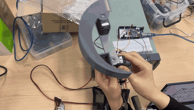
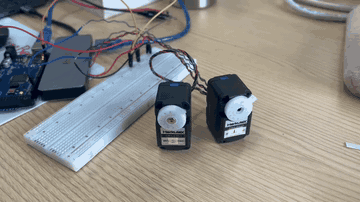
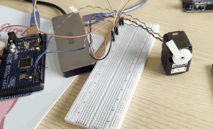
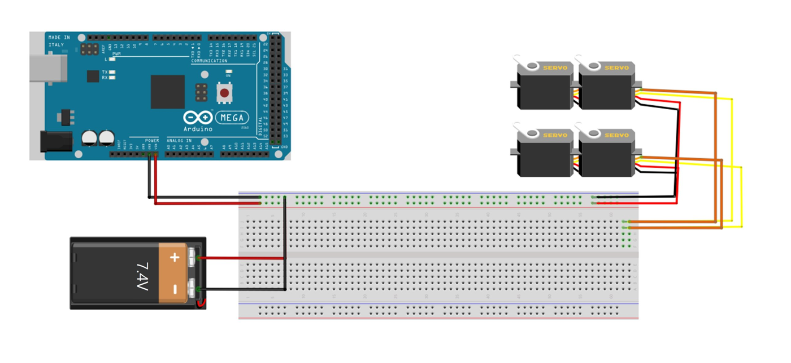
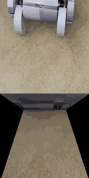
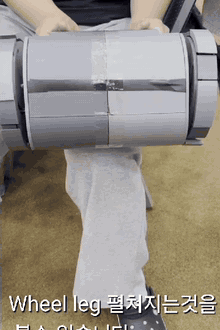
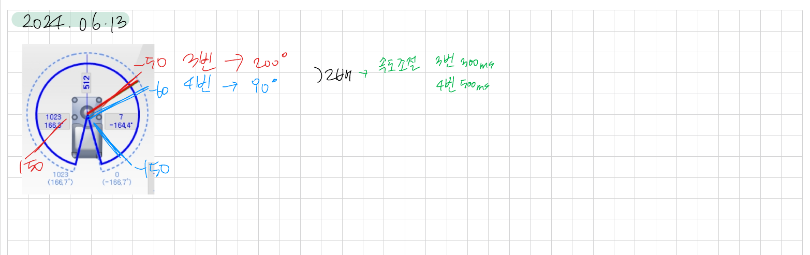

# Wheel-leg 탐사 로봇 (Wheel-leg Rover)

| 항목 | 내용 |
|---|---|
| 과목 | 캡스톤디자인2 (2024.03–06) |
| 팀 | 5인 |
| 역할 | 팀원, 꼬리 구동부 전담 — Herkulex 서보 제어, 회로도, 통합 시험 |
| 수상 | 2024 캡스톤디자인 경진대회 우수상, 2024 창의대첩 창의상 (팀) |

## 1. 개요

평지에서는 원통형 몸체로 굴러가고, 험지에서는 바퀴를 펼쳐(Wheel-leg) 이동하는 탐사 로봇.
2-Link 꼬리로 지면을 밀어 전진을 돕고 무게중심을 조정함.

## 2. 시연

| 꼬리 구동 | 꼬리 2축 서보 시험 |
|---|---|
|  |  |

| Herkulex 연속 회전 시험 | 꼬리 서보 전원 회로 (Fritzing) |
|---|---|
|  |  |

| [팀 결과] 주행 | [팀 결과] 바퀴 펼침 |
|---|---|
|  |  |

## 3. 시스템 구성 (꼬리·휠레그 구동부)

```text
Arduino Mega 2560
    │ UART (Serial1), 115200 bps
    ▼
Herkulex 서보
    ├─ 왼쪽 꼬리 : 2축 (ID 1, 2)
    ├─ 오른쪽 꼬리 : 2축 (ID 3, 4)
    └─ 휠레그 기어 구동 : 연속 회전 2개 (ID 5, 6)
```

## 4. 담당 범위

| 구분 | 내용 |
|---|---|
| 본인 | 2-Link 꼬리 구조 구체화·스케치 (팀원과 함께, 모델링은 팀원) |
| 본인 | HerkuleX Manager로 서보 ID 설정, 단독 구동 확인 |
| 본인 | 꼬리 서보 4개 제어 코드 작성, 축별 목표 각도·이동 시간 설계 |
| 본인 | 휠레그 기어 구동용 Herkulex 2개 연속 회전 시험 코드 작성 |
| 본인 | 팀 통합 코드의 `k`(꼬리 돌출·복귀), `o`(휠레그 펼침) 명령 작성 |
| 본인 | 꼬리 서보 전원 회로 및 전체 회로도 작성 (Fritzing) |
| 본인 | 통합 후 꼬리 오류의 원인 후보 분리 시험 |
| 본인 | Raspberry Pi 5 원격 환경(SSH·VNC) 구성, 카메라 실시간 송출 (Picamera2 + MJPEG) |
| 팀 | 전체 기구 설계·CAD, Bluetooth 제어, 기어드 DC 모터 주행, 엔코더 기반 위치 제어, 리니어 액추에이터 |

## 5. 꼬리 동작 설계

설계 메모 (연구노트, 2024.06.13):



| 서보 | 위치 A | 위치 B | 이동 시간 |
|---|---:|---:|---:|
| ID 3 | 150° | −50° | 300 ms |
| ID 4 | −150° | −60° | 500 ms |

| 파일 | 내용 |
|---|---|
| [`src/tail_movement_1.ino`](src/tail_movement_1.ino) | 꼬리 구동 원본 (본인 작성, 오타 1곳 포함) |
| [`src/tail_movement_1_cleanup.ino`](src/tail_movement_1_cleanup.ino) | 위 원본에서 ID 오타·미사용 변수만 정리한 사본 (프로젝트 이후 작성) |
| [`src/inf_turn_Herkulex.ino`](src/inf_turn_Herkulex.ino) | Herkulex 연속 회전 시험 원본 (본인 작성) |

팀 통합 코드 중 본인 작성 부분: [`docs/integration-contribution.md`](docs/integration-contribution.md)

## 6. 통합 시험 — 꼬리 서보 오류

꼬리별(서보 2개씩)로 각도를 맞춘 뒤 팀 통합 코드에 합쳤고, 통합 후 꼬리 서보 오류가 발생함.

### 6.1 후보 시험 (2024.06.24 연구노트)

| 후보 | 시험 방법 | 결과 |
|---|---|---|
| 과부하 | 걸림 없이 꼬리만 구동 | 오류 지속 → 배제 |
| 과열 | 시작 직후 오류 발생 여부 확인 | 시작 직후 오류·LED 점멸 → 배제 |
| 전원 | 서보 4개에만 파워서플라이로 별도 공급 | 오류 지속 → 배제 |
| 통신 | Arduino Mega에 직접 연결해 전송 | 오류 지속 → 배제 |
| 모터 | — | 미확인 |
| 코드 타이밍 | — | 미확인 |

- 점검 화면 (HerkuleX Manager, ID 3): 온도 30.7 °C, 입력 7.6 V, 오류 없음.

### 6.2 조건 비교

| 구성 | 결과 |
|---|---|
| 꼬리 1개 (서보 2개) | 정상 |
| 꼬리 2개 (서보 4개) 연결 | 오류, LED 점멸 |

### 6.3 결과

- 원인 미확정. 4개 후보를 배제하고 "서보 4개 동시 구동"이라는 발생 조건까지 범위를 좁힘.
- 다음 적용 사항: 통합 전에 최종 조건(서보 4개 동시)으로 먼저 시험하고, 정상·오류 조건의 서보 상태 값을 바로 기록.

상세: [`docs/integration-debugging.md`](docs/integration-debugging.md)
