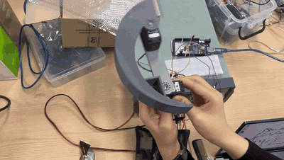
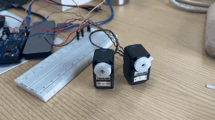
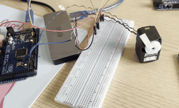
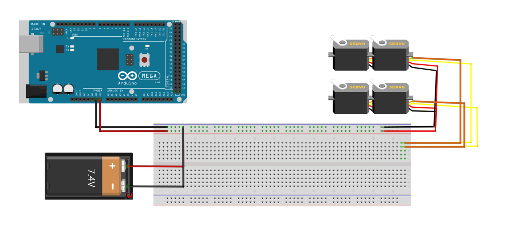
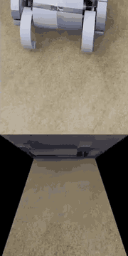
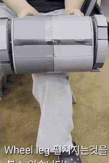
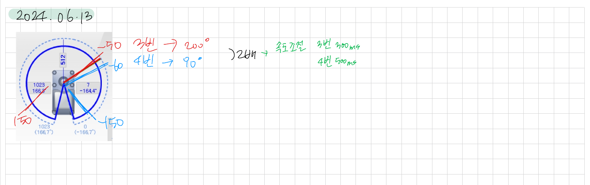

# Wheel-leg 탐사 로봇 (Wheel-leg Rover)

| 항목 | 내용 |
|---|---|
| 과목 | 캡스톤디자인2 (2024.03–06) |
| 팀 | 5인 |
| 역할 | 팀원, 꼬리 구동부 전담 — Herkulex 서보 제어, 회로도, 통합 시험 |
| 수상 | 2024 캡스톤디자인 경진대회 우수상, 2024 창의대첩 창의상 (팀) |

## 1. 개요

평지에서는 원통형 몸체로 굴러가고, 험지에서는 바퀴를 펼쳐 이동하는 것을 목표로 한 탐사 로봇. 본인은 꼬리 구동부의 목표 각도·이동 시간 설계, UART 제어, 전원 회로와 카메라 송출을 담당함.

꼬리별 서보 2개 정상 구동을 확인했으며, 4개 동시 구동 오류의 최종 원인은 미확정. 아래 주행·바퀴 펼침 영상은 팀 결과임.

## 2. 시연

| 꼬리별 구동 시험 (서보 2개) | 꼬리 2축 서보 시험 |
|---|---|
|  |  |

| Herkulex 연속 회전 시험 | 꼬리 서보 전원 회로 (Fritzing) |
|---|---|
|  |  |

| [팀 결과] 주행 | [팀 결과] 바퀴 펼침 |
|---|---|
|  |  |

## 3. 시스템 구성 (꼬리·휠레그 구동부)

```text
Arduino Mega 2560
    │ UART (Serial1), 115200 bps
    ▼
Herkulex 서보
    ├─ 왼쪽 꼬리 : 2축 (ID 1, 2)
    ├─ 오른쪽 꼬리 : 2축 (ID 3, 4)
    └─ 휠레그 기어 구동 : 연속 회전 2개 (ID 5, 6)
```

## 4. 담당 범위

| 구분 | 내용 |
|---|---|
| 본인 | 2-Link 꼬리 구조 구체화·스케치 (팀원과 함께, 모델링은 팀원) |
| 본인 | HerkuleX Manager로 서보 ID·위치 한계 설정, 꼬리별 구동 확인 |
| 본인 | 꼬리 서보 4개 제어 코드 구현, 축별 목표 각도·이동 시간 설계 |
| 본인 | 휠레그 기어 구동용 Herkulex 2개 연속 회전 시험 코드 구현 |
| 본인 | 팀 통합 코드의 `k` 꼬리 제어와 `o` 중 Herkulex 연속 회전·팀 함수 호출 흐름 구현. DC helper 내부는 팀원 작성 |
| 본인 | 꼬리 서보 전원 회로 및 전체 회로도 작성 (Fritzing) |
| 본인 | 통합 후 꼬리 오류의 원인 후보 분리 시험 |
| 본인 | Raspberry Pi 5 원격 환경(SSH·VNC) 구성, Picamera2·MJPEG 예제를 환경에 맞게 수정·적용해 실시간 카메라 송출 |
| 팀 | 전체 기구 설계·CAD, Bluetooth 제어, 기어드 DC 모터 주행, 엔코더 기반 위치 제어, 리니어 액추에이터 |

## 5. 꼬리 동작 설계

설계 메모 (연구노트, 2024.06.13):



| 서보 | 위치 A | 위치 B | 이동 시간 |
|---|---:|---:|---:|
| ID 3 | 150° | −50° | 300 ms |
| ID 4 | −150° | −60° | 500 ms |

| 파일 | 내용 |
|---|---|
| [`src/tail_movement_1.ino`](src/tail_movement_1.ino) | 꼬리 구동 원본 (본인 구현, 오타 1곳 포함) |
| [`src/tail_movement_1_cleanup.ino`](src/tail_movement_1_cleanup.ino) | 위 원본에서 ID 오타·미사용 변수만 정리한 사본 (프로젝트 이후 작성) |
| [`src/inf_turn_Herkulex.ino`](src/inf_turn_Herkulex.ino) | Herkulex 연속 회전 시험 원본 (본인 구현) |

팀 통합 코드 중 본인 구현 부분: [`docs/integration-contribution.md`](docs/integration-contribution.md)

## 6. 통합 시험 — 꼬리 서보 오류

꼬리별(서보 2개씩)로 각도를 맞춘 뒤 팀 통합 코드에 합쳤고, 통합 후 꼬리 서보가 동작 중 오류(LED 점등)로 멈춤.

### 6.1 후보 시험 (2024.06.24 연구노트)

| 후보 | 시험 방법 | 결과 (이 시험 조건에서의 판단) |
|---|---|---|
| 과부하 | 걸림 없이 꼬리만 구동 | 오류 지속 → 가능성 낮음 |
| 과열 | 시작 직후 오류 발생 여부 확인 | 시작 직후 오류·LED 점멸 → 가능성 낮음 |
| 전원 | 서보 4개에만 파워서플라이로 별도 공급 | 오류 지속 → 가능성 낮음 |
| 통신 | Arduino Mega에 직접 연결해 전송 | 오류 지속 → 가능성 낮음 |

- 점검 화면의 ID 3은 해당 시점에 온도 30.7 °C, 입력 7.6 V, 오류 없음. 4개 서보 전체 또는 모든 시험 조건의 정상 상태를 의미하지 않음.
- 오류 상태 코드를 출력해 서보별 오류를 확인하고, 매뉴얼을 참고해 원인을 좁히려 함.

### 6.2 조건 비교

| 구성 | 결과 |
|---|---|
| 꼬리 1개 (서보 2개) | 정상 |
| 꼬리 2개 (서보 4개) 연결 | 오류 |

아래 2개·4개 조건 비교와 과열 조건 시험의 시작 직후 LED 점멸은 관찰 맥락이 다름.

### 6.3 결과

- 원인 미확정. 조건별 시험으로 원인 가능성을 좁혔고, "서보 4개 동시 구동"이라는 발생 조건까지 확인함.
- 다음 적용 사항: 통합 전에 최종 조건(서보 4개 동시)으로 먼저 시험하고, 정상·오류 조건의 서보 상태 값을 바로 기록.

상세: [`docs/integration-debugging.md`](docs/integration-debugging.md)
