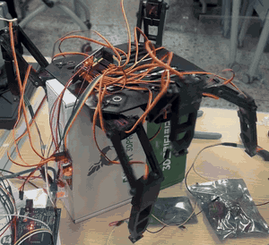

# Robotics & Embedded Systems Portfolio

센서 입력, 제어 판단, 액추에이터 출력이 연결된 실물 장치에서 제어 코드를 작성하고, 통합 단계의 오류를 시험으로 좁힌 기록을 정리한 저장소.

| 항목 | 내용 |
|---|---|
| 작성자 | 이효련 (원광대학교 전자융합공학과 졸업) |
| 주요 주제 | 다축 서보 제어(I2C·PWM, UART), 센서 기반 조건 제어, 통합 시험·원인 분리 |
| 지원 분야 | Embedded Control / System Integration / Test & Validation |

---

## 1. 대표 프로젝트

| 6족 랜딩기어 — 트라이포드 보행 시험 | Wheel-leg — Herkulex 꼬리 구동 |
|---|---|
|  |  |

| 프로젝트 | 기간 | 역할 | 핵심 구성 | 주요 기록 |
|---|---|---|---|---|
| [6족 드론 랜딩기어](01_hexapod_drone/) | 2023.09–12 | 팀장 (5인), 랜딩기어 제어·센서 | Arduino Mega, PCA9685 ×2 (I2C), MG90S ×18, 압력센서(FSR) | 18축 채널 매핑, 6번 다리 매핑 오류 수정 |
| [Wheel-leg 탐사 로봇](02_wheel_leg_rover/) | 2024.03–06 | 팀원 (5인), 꼬리 구동부 전담 | Herkulex DRS-0101 ×4, UART 115200 bps | 통합 후 꼬리 오류의 원인 후보 시험·배제 |

## 2. 기타 경험

| 프로젝트 | 내용 |
|---|---|
| i-HARBOR (i-CAPS 국제 공동 캡스톤, Team 17 팀장) | Raspberry Pi 5 OS·SSH·VNC 환경 구성, Flask + gpiozero로 서보·LED 웹 제어 프로토타입 구현 |
| 진동 에너지 하베스팅 (창의공학설계) | 아두이노 전압 측정 회로·프로그램 작성, 오실로스코프로 정류 전 코일 출력 측정 (커서 기준 피크 간 최대 약 14.1 V, +7.64 / −6.44 V) |

---

## 3. 기술 요약

| 영역 | 사용 내용 | 근거 |
|---|---|---|
| 언어 | C (Arduino), Python | 각 프로젝트 `src/` |
| MCU / SBC | Arduino Mega 2560, Raspberry Pi 5 | 6족, Wheel-leg, i-HARBOR |
| 인터페이스 | I2C (PCA9685 0x40/0x41), PWM 50 Hz, UART (Herkulex 115200 bps), GPIO | 6족, Wheel-leg |
| 액추에이터 | MG90S 호환 서보 ×18, Herkulex 서보 ×6 (꼬리 4, 휠레그 기어 2) | 6족, Wheel-leg |
| 센서 | 압력센서(FSR) | 6족 |
| 시험·계측 | 채널 매핑 대조, 원인 후보별 분리 시험, 오실로스코프, HerkuleX Manager | 6족, Wheel-leg, 하베스팅 |
| 도구 | Arduino IDE, Fritzing, Git/GitHub | — |

---

## 4. 저장소 구성

```text
.
├── 01_hexapod_drone/      # 6족 드론 랜딩기어
│   ├── README.md
│   ├── src/               # 프로젝트 당시 원본 코드
│   ├── docs/              # 디버깅 기록
│   └── media/
├── 02_wheel_leg_rover/    # Wheel-leg 탐사 로봇
│   ├── README.md
│   ├── src/
│   ├── docs/
│   └── media/
└── NOTICE.md              # 팀 프로젝트 자료의 공개 범위
```

## 5. 작성 기준

- 대표 프로젝트는 모두 팀 프로젝트이며, 각 README에서 **담당 범위**와 **팀 범위**를 구분함.
- `src/`의 코드는 본인이 작성한 프로젝트 당시 원본이며, 이후 정리한 사본은 파일명과 설명에 별도로 표기함.
- 원인을 확정하지 못한 문제는 "미확정"으로 기록함.
