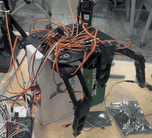
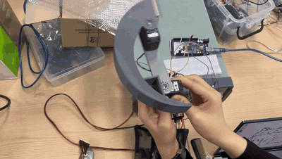

# Robotics & Embedded Systems Portfolio

센서 입력, 제어 판단, 액추에이터 출력이 연결된 실물 장치에서 제어 코드를 구현하고, 통합 단계의 오류를 시험으로 좁힌 기록을 정리한 저장소.

| 항목 | 내용 |
|---|---|
| 작성자 | 이효련 (원광대학교 전자융합공학과 졸업) |
| 주요 주제 | 다축 서보 제어(I2C·PWM, UART), 센서 기반 조건 제어, 통합 시험·원인 분리 |
| 지원 분야 | 임베디드 SW·펌웨어 / 로봇 구동 제어 / 시스템 연동·시험 |

---

## 1. 대표 프로젝트

| 6족 랜딩기어 — 다축 다리 구동 시험 (몸체 지지) | Wheel-leg — Herkulex 꼬리 구동 |
|---|---|
|  |  |

| 프로젝트 | 기간 | 역할 | 핵심 구성 | 주요 기록 |
|---|---|---|---|---|
| [6족 드론 랜딩기어](01_hexapod_drone/) | 2023.09–12 | 팀장 (5인), 랜딩기어 제어·센서 | Arduino Mega, PCA9685 ×2 (I2C), MG90S ×18, 압력센서(FSR) | 18축 관절·채널 매핑과 트라이포드 전진 루틴 구현, 별도 단일 다리 FSR 정지·자세 유지, 6번 다리 매핑 수정 |
| [Wheel-leg 탐사 로봇](02_wheel_leg_rover/) | 2024.03–06 | 팀원 (5인), 꼬리 구동부 전담 | Herkulex DRS-0101 꼬리용 ×4, UART 115200 bps | 목표 각도·이동 시간 설계와 UART 제어 구현. 꼬리별 2개 정상, 4개 동시 구동 오류의 최종 원인 미확정 |

## 2. 기타 경험

| 프로젝트 | 내용 |
|---|---|
| i-HARBOR (i-CAPS 국제 공동 캡스톤, Team 17 팀장) | Raspberry Pi 5 OS·SSH·VNC 환경 구성, Flask + gpiozero로 서보 1개·LED 웹 제어 기능 구현·동작 확인, 구현 내용을 발표 자료에 수록 |
| 진동 에너지 하베스팅 (창의공학설계) | Arduino A/D 0.1초 측정·시리얼 기록 코드와 MATLAB 코일 권선 길이·저항 계산 코드 작성. 별도 오실로스코프 측정: 손으로 흔든 정류 전 코일 출력의 커서 기준 피크 간 최대 약 14.1 V |

---

## 3. 기술 요약

| 영역 | 사용 내용 | 근거 |
|---|---|---|
| 언어 | C/C++ (Arduino), Python, MATLAB | 공개 `src/`는 6족·Wheel-leg 코드. 기타 경험은 위 요약에 수행 범위 표기 |
| MCU / SBC | Arduino Mega 2560, Raspberry Pi 5 | 6족, Wheel-leg, i-HARBOR |
| 인터페이스 | I2C (PCA9685 0x40/0x41), PWM 50 Hz, UART (Herkulex 115200 bps), GPIO | 6족, Wheel-leg |
| 액추에이터 | MG90S 호환 서보 ×18, Herkulex 서보 ×6 (꼬리 4, 휠레그 기어 2) | 6족, Wheel-leg |
| 센서 | 압력센서(FSR) | 6족 |
| 시험·계측 | 채널 매핑 대조, 원인 후보별 분리 시험, 오실로스코프, HerkuleX Manager | 6족, Wheel-leg, 하베스팅 |
| 도구 | Arduino IDE, Fritzing, Git/GitHub | — |

---

## 4. 저장소 구성

```text
.
├── 01_hexapod_drone/      # 6족 드론 랜딩기어
│   ├── README.md
│   ├── src/               # 프로젝트 당시 원본 코드
│   ├── docs/              # 디버깅 기록
│   └── media/
├── 02_wheel_leg_rover/    # Wheel-leg 탐사 로봇
│   ├── README.md
│   ├── src/
│   ├── docs/
│   └── media/
└── NOTICE.md              # 팀 프로젝트 자료의 공개 범위
```

## 5. 작성 기준

- 대표 프로젝트는 모두 팀 프로젝트이며, 각 README에서 **담당 범위**와 **팀 범위**를 구분함.
- 프로젝트 당시 코드와 이후 정리한 사본을 각 파일 설명에서 구분함. 코드·영상이 보여 주는 범위와 최종 동작 확인 범위를 구분해 설명함.
- 원인을 확정하지 못한 문제는 "미확정"으로 기록함.
